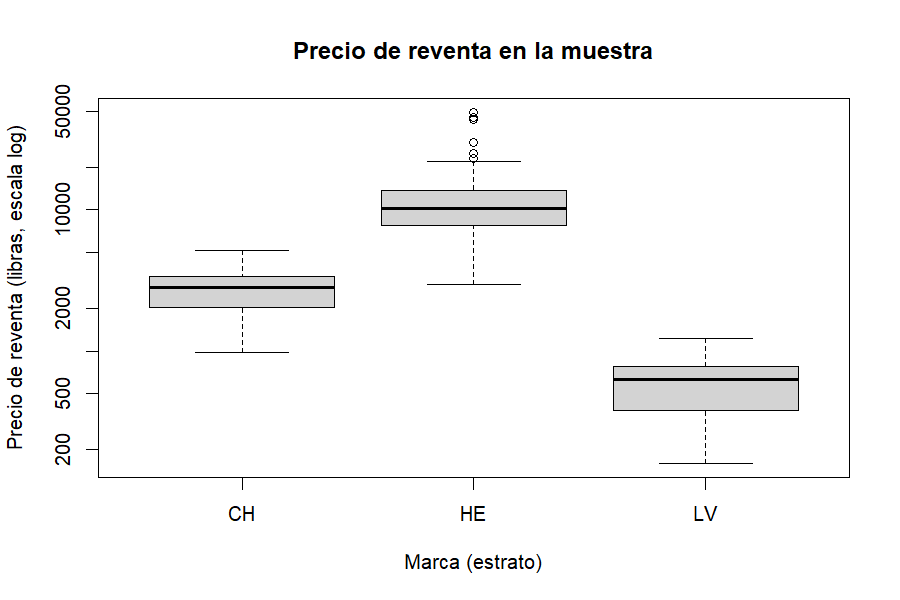
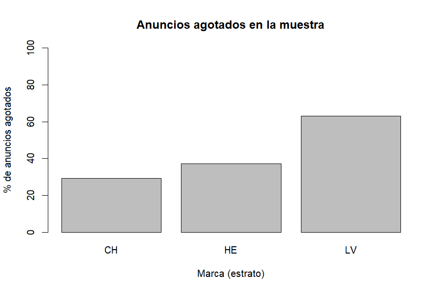
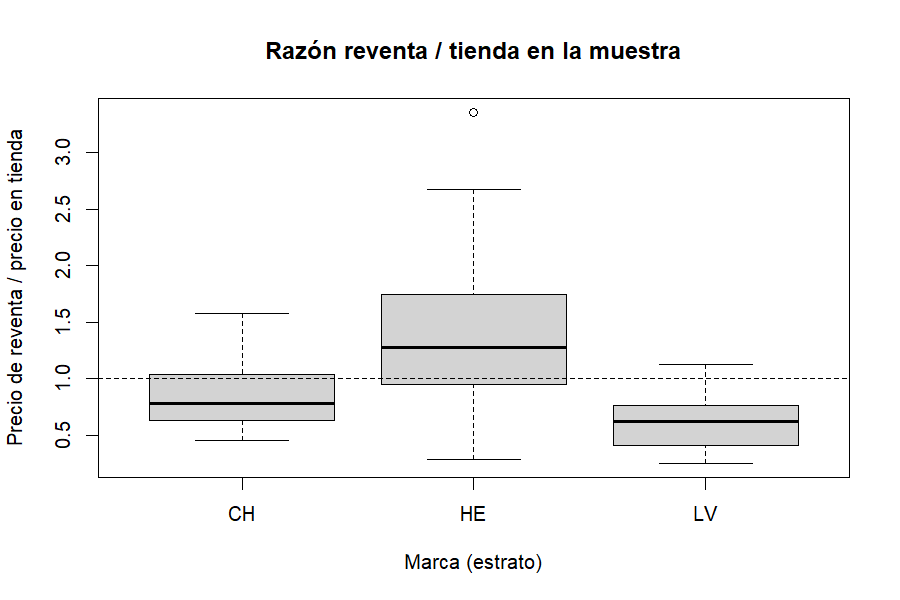

# Avance (Hito 3)

**Proyecto:** Precio de reventa de bolsos de lujo (Louis Vuitton, Chanel y Hermès) en Vestiaire Collective
**Integrantes:** Karol Ximena Salcedo Ponguta y Mariana Lizarazo Buitrago
**Fecha de este avance:** 14 de noviembre de 2026 (posterior al cierre del 6 de noviembre; ver desviación 1)

## 1. Qué se hizo

El marco es un archivo público, así que no hay trabajo de campo con personas: el «campo» consiste en levantar, desde el archivo, los datos de cada anuncio seleccionado.

1. **Selección.** Con `R/seleccion.R` se seleccionó la muestra: estratificado por marca, aleatorio simple sin reemplazo dentro de cada estrato y asignación de Neyman. Son 150 anuncios: 34 de Chanel, 89 de Hermès y 27 de Louis Vuitton. La semilla fue 20261113 y la selección se corrió una sola vez. El resultado está en `datos/muestra.csv`, con la probabilidad de inclusión y el peso de cada anuncio (los pesos suman 11.988).
2. **Levantamiento de datos.** Con `R/datos.R` se tomaron del archivo los datos de los 150 anuncios (`datos/datos.csv`). Un anuncio cuenta como «respondió» si tiene las tres variables de estudio: precio de reventa, estado de agotado y precio en tienda.
3. **Comprobación del guion de selección.** Con `R/comprobacion.R`; el resultado está en `datos/bitacora.md`.

## 2. Tasa de respuesta

| Estrato | Seleccionados | Respondieron | Tasa |
|---|---|---|---|
| Chanel (CH) | 34 | 34 | 100,0 % |
| Hermès (HE) | 89 | 89 | 100,0 % |
| Louis Vuitton (LV) | 27 | 25 | 92,6 % |
| **Total** | **150** | **148** | **98,7 %** |

## 3. No respuesta

No respondieron 2 anuncios, ambos de Louis Vuitton (`A02223` y `A02500`): no tienen el precio en tienda. Siguen en la muestra y no se sustituyeron por otros. Como su precio de reventa y su estado de agotado sí están, entran en la estimación del precio medio y de la proporción de agotados; solo se excluyen de la estimación de la razón, donde los pesos se ajustan por clases de respuesta iguales a los estratos, como dice el protocolo. Ese ajuste supone que, dentro de cada marca, que falte el precio en tienda no depende del valor de la razón.

En el marco hay 132 anuncios sin precio en tienda, 127 de ellos de Louis Vuitton. Con la muestra de 27 anuncios de LV se esperaría menos de uno sin ese dato; encontrar 2 es compatible con el azar.

## 4. Desviaciones del protocolo

| N.º | El protocolo decía | Qué pasó | Efecto en la estimación |
|---|---|---|---|
| 1 | Protocolo cerraba el 30 de octubre, avance el 6 de noviembre y campo el 13 de noviembre. | El repositorio se creó y las entregas se hicieron el 14 de noviembre. | Ninguno. La selección se hizo con el diseño y la semilla ya escritos en el protocolo. |
| 2 | La semilla la publicaba el docente. | No se recibió una semilla publicada. Se usó la `20261113`, que ya estaba escrita en `R/seleccion.R` y en `protocolo.md`, y se corrió una sola vez. | Ninguno en el diseño: las probabilidades de inclusión son las del protocolo. Solo cambia qué muestra concreta salió. |

**Observación sobre el piloto (no es una desviación del procedimiento).** Como el marco es el archivo completo, se conoce la desviación estándar real del precio en cada marca: 1.453 (CH), 9.487 (HE) y 901 (LV), frente a 1.016, 3.298 y 526 del piloto. Con las desviaciones reales y la asignación 34/89/27, el margen esperado al 95 % para el precio medio sería de unos £518, y no los £213 del protocolo. El protocolo ya advertía que el piloto podía subestimar la variabilidad, sobre todo en Hermès. No cambia el diseño ni las probabilidades de inclusión; se discutirá en el informe.

## 5. Resumen descriptivo de lo recogido

Lo siguiente describe la **muestra**, sin pesos y sin intervalos. No son estimaciones de la población.

| Marca | n | Respondieron | Precio medio (£) | Precio mediana (£) | % agotado | Razón media |
|---|---|---|---|---|---|---|
| CH | 34 | 34 | 2.843 | 2.801 | 29,4 | 0,87 |
| HE | 89 | 89 | 11.877 | 10.138 | 37,1 | 1,34 |
| LV | 27 | 25 | 616 | 625 | 63,0 | 0,62 |

## 6. Qué sigue

Estimar con el diseño declarado en `survey` (`R/estimacion.R`), con errores estándar, intervalos y efecto de diseño; comprobar si los intervalos contienen los parámetros del archivo completo; y escribir el informe (Hito 4, cierra el 23 de noviembre).
